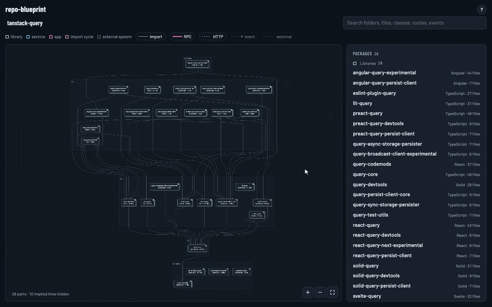

# repo-blueprint

[](https://www.npmjs.com/package/repo-blueprint)
[](LICENSE)
[](package.json)

**See how a codebase fits together in one command.** repo-blueprint reads your TypeScript and Python source and turns it into a zoomable architecture map, with every package, folder and file stacked by what depends on what.



<sub>The 28 packages of the [TanStack Query](https://github.com/TanStack/query) monorepo.</sub>

```bash
npx repo-blueprint build --open
```

## Why

- **Layers, not spaghetti.** Parts sit in dependency tiers, from entry points at the top down to the base everything builds on. Zoom from the whole repo into a package, a folder, then a single file.
- **Everything that connects.** Imports, RPC calls, HTTP calls, events and external systems (databases, brokers, vendors) are drawn as lines between parts.
- **Findings for free.** Import cycles, misplaced packages, unused libraries and orphan files are flagged from fixed rules.
- **Search anything.** Jump straight to any folder, file, class, route or event.
- **Deterministic.** Pure static analysis through the TypeScript compiler and Python's own parser. No AI guessing: the same commit and the same version always produce the same page.
- **One file.** The output is a single standalone HTML page you can open, share or commit.
- **Live mode.** `watch` keeps the map open in your browser and redraws it as you code.

## Quick start

Requires Node.js 18.17 or newer. Python repos also need Python 3.10+ or [uv](https://docs.astral.sh/uv/).

```bash
npx repo-blueprint build [repo] [--out file] [--open]
npx repo-blueprint watch [repo] [--port 4321] [--open]
```

- `build` writes the page once, to `~/.repo-blueprint/<repo>.blueprint.html` unless `--out` says otherwise, and prints a summary.
- `watch` serves the page on localhost and rebuilds it whenever source files change.
- `repo` defaults to the current directory.

## With an agent

repo-blueprint ships as an agent skill, so Claude Code and other agents can draw the map for you.

```bash
npx skills add MohGanji/repo-blueprint
```

Or copy [`skills/repo-blueprint/SKILL.md`](skills/repo-blueprint/SKILL.md) into your agent's skills folder. Then ask for "a blueprint of this repo", or "a live blueprint I can keep open while I work". The skill runs this package through `npx`, pinned to an exact version.

## What it understands

- **TypeScript and JavaScript:** any folder with a `package.json` and a `tsconfig.json`, at any depth. Imports are resolved through the project's own tsconfig paths.
- **Python:** any folder with a `pyproject.toml`.
- **Roles:** each package is shown as an app, service or library. A declared type wins (Backstage `catalog-info.yaml`, Nx `project.json`). Otherwise the role comes from the code: an entry file that mounts a UI is an app, one that starts a server or worker is a service, and anything else is a library.

## Per-repo settings

A `.blueprint.json` at the root of the analysed repo extends the [defaults](src/blueprint.config.json):

- `externalSystems`: system names and the packages that indicate them, for example `{ "Stripe": ["stripe"] }`.
- `messaging`: method and property names for RPC calls, publishes and subscriptions.
- `folderRoles`: folder names that imply a role, used for the role-mismatch finding.
- `sdkDirs`: folder names whose subfolders are generated API clients named after the services they call.

## How it works

```
bin/repo-blueprint.mjs        CLI: build and watch
src/extract-ts.mjs            TypeScript facts via the compiler API
src/extract-py.py             Python facts via the ast module
src/model.mjs                 packages, folder tree, edges, roles, findings
src/views.mjs                 one Pele diagram per folder
src/build.mjs                 writes the standalone HTML
src/template.html             the page
src/blueprint.config.json     default settings
skills/repo-blueprint/        the agent skill
.claude-plugin/plugin.json    Claude Code plugin manifest
```

## Contributing

Issues and pull requests are welcome. See [CONTRIBUTING.md](CONTRIBUTING.md).

## License

[MIT](LICENSE)
